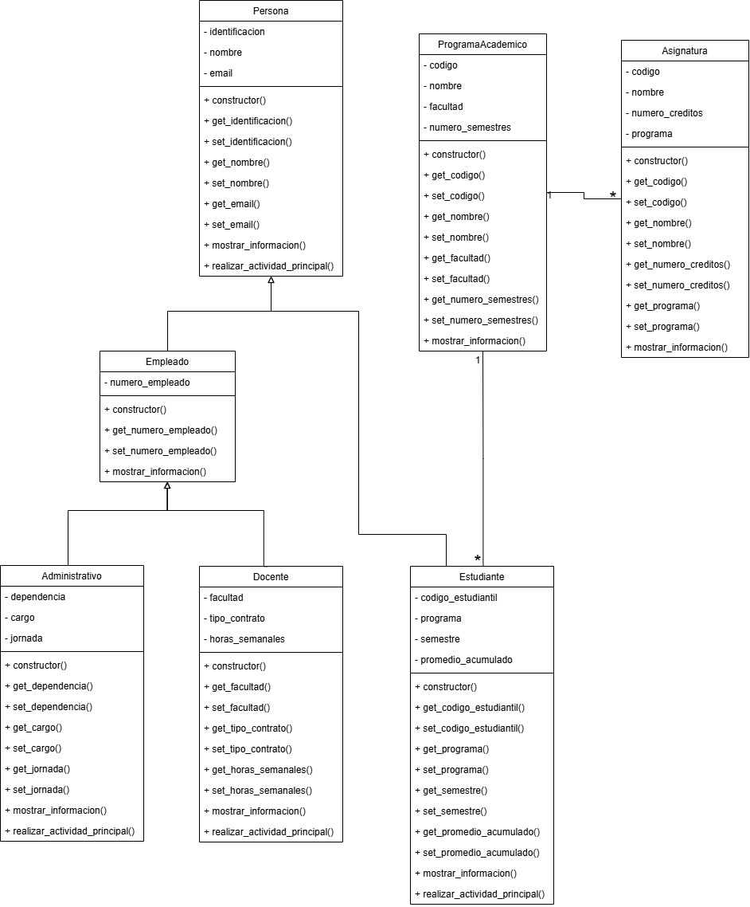

# Sistema de gestión académica de la universidad

Proyecto en Python que organiza la información de una universidad: sus personas (estudiantes, docentes y administrativos), sus programas académicos, sus asignaturas y, desde la Actividad Colaborativa 2, la oferta de grupos académicos y la matrícula de estudiantes.

Este repositorio contiene un único proyecto que evoluciona entre actividades. La versión de la Actividad Colaborativa 1 permanece identificable con la etiqueta `entrega-1`.

## Integrantes

- Santiago Palacio Castañeda

## Descripción general del sistema

- **Persona** es una clase abstracta: guarda lo que todas las personas comparten (identificación, nombre y email) y define el método abstracto `realizar_actividad_principal()`.
- **Estudiante**, **Docente** y **Administrativo** son los tipos concretos de persona, cada uno con sus propios datos.
- **Empleado** agrupa lo que comparten docentes y administrativos: el número de empleado.
- **ProgramaAcademico** guarda código, nombre, facultad y número de semestres.
- **Asignatura** guarda código, nombre, créditos y el objeto `ProgramaAcademico` al que pertenece.
- **Horario** representa cuándo y dónde se desarrolla un grupo: día, hora de inicio, hora de fin y salón.
- **GrupoAcademico** representa una oferta de una asignatura: código, objeto `Asignatura`, objeto `Docente` responsable, capacidad máxima, objeto `Horario` y la lista de objetos `Estudiante` matriculados.
- **Catalogo** guarda las asignaturas y los programas para poder buscarlos por código.
- **excepciones.py** define las excepciones personalizadas del sistema.

Todos los atributos son privados (encapsulamiento). Se consultan con métodos `get_...` y se modifican con métodos `set_...`, que validan el valor y lanzan un `ValueError` si no es válido.

## Diagrama de clases



El diagrama corresponde a la versión de la Actividad Colaborativa 1. El archivo editable (`docs/diagrama_de_clases.drawio`) se abre con [draw.io](https://app.diagrams.net).

## Estructura de los archivos

```
Proyecto_Universidad/
├── main.py                  # Programa principal: crea objetos y ejecuta las pruebas
├── persona.py               # Clase abstracta Persona
├── empleado.py              # Clase Empleado (hereda de Persona)
├── estudiante.py            # Clase Estudiante (hereda de Persona)
├── docente.py               # Clase Docente (hereda de Empleado)
├── administrativo.py        # Clase Administrativo (hereda de Empleado)
├── programa_academico.py    # Clase ProgramaAcademico
├── asignatura.py            # Clase Asignatura
├── horario.py               # Clase Horario
├── grupo_academico.py       # Clase GrupoAcademico
├── catalogo.py              # Clase Catalogo (búsqueda de asignaturas y programas)
├── excepciones.py           # Excepciones personalizadas
├── docs/
│   ├── diagrama_de_clases.drawio
│   └── diagrama_de_clases.png
└── README.md
```

## Instrucciones para ejecutar el proyecto

1. Instalar [Python 3](https://www.python.org/downloads/) (el proyecto no usa librerías externas).
2. Clonar el repositorio:
   ```
   git clone https://github.com/santiagopalacio99-sys/Proyecto_Universidad.git
   ```
3. Entrar a la carpeta del proyecto:
   ```
   cd Proyecto_Universidad
   ```
4. Ejecutar el archivo principal:
   ```
   python main.py
   ```

## Qué demuestra `main.py`

**Actividad Colaborativa 1:** creación de programas y una asignatura, seis personas en una única lista, consulta de información, modificación válida de datos, tres intentos de valores inválidos y el recorrido polimórfico de la lista con un único ciclo `for`.

**Actividad Colaborativa 2:**

1. Que no se puede crear directamente una `Persona`.
2. La creación de asignaturas, docentes, estudiantes y horarios.
3. La creación de dos grupos académicos.
4. La matrícula correcta de estudiantes.
5. El intento de matricular un estudiante duplicado.
6. El intento de superar la capacidad de un grupo.
7. El retiro correcto de un estudiante.
8. El intento de retirar un estudiante que no está matriculado.
9. La búsqueda de una asignatura inexistente.
10. La búsqueda de un programa inexistente.
11. La continuidad del programa después de controlar cada excepción.

## Clase abstracta

`Persona` hereda de `ABC` y su método `realizar_actividad_principal()` está decorado con `@abstractmethod`. Una persona sin tipo (que no sea estudiante, docente ni administrativo) no tiene sentido en el sistema, así que Python impide crear objetos de `Persona` directamente y lanza un `TypeError`. `Estudiante`, `Docente` y `Administrativo` implementan el método con su propio comportamiento:

- `Estudiante` informa qué programa cursa y en qué semestre está.
- `Docente` informa en qué facultad orienta clases.
- `Administrativo` informa qué cargo desempeña y en qué dependencia trabaja.

`Empleado` no implementa el método, por lo que también es abstracta y nunca se crea directamente.

## Herencia, sobreescritura y polimorfismo

**Herencia.** `Estudiante` hereda de `Persona`. `Docente` y `Administrativo` comparten el número de empleado, por lo que heredan de la clase intermedia `Empleado`, que hereda de `Persona`. Cada clase hija llama a `super().__init__(...)` para que su clase madre guarde los datos generales.

```
Persona (abstracta)
├── Estudiante
└── Empleado
    ├── Docente
    └── Administrativo
```

**Sobreescritura.** Las clases hijas redefinen `mostrar_informacion()` (llamando primero a `super().mostrar_informacion()`) y `realizar_actividad_principal()`, con el mismo nombre y un comportamiento propio.

**Polimorfismo.** En `main.py` los seis objetos viven en una sola lista que se recorre con un único ciclo `for`. En cada vuelta se llama a `mostrar_informacion()` y a `realizar_actividad_principal()` sin preguntar el tipo del objeto. Este comportamiento se mantiene en esta versión: la clase `Persona` sigue siendo la clase base común, y `GrupoAcademico` recibe docentes y estudiantes que siguen respondiendo a los mismos métodos.

## Relación entre el grupo académico y el horario

`GrupoAcademico` contiene un objeto `Horario` en su atributo `_horario`. Es una relación de **composición** ("un grupo *tiene un* horario") y no de herencia, por estas razones:

- **No cumple la regla "es un".** Un grupo no es un tipo de horario, ni un horario es un tipo de grupo. Con herencia, un grupo recibiría los atributos y métodos de un horario sin que eso tenga sentido.
- **Cada clase tiene su propia responsabilidad.** `Horario` solo sabe describir cuándo y dónde se reúne un grupo (día, hora de inicio, hora de fin y salón) y valida sus datos. `GrupoAcademico` se encarga de la matrícula.
- **El horario describe a un grupo concreto.** No tiene sentido por sí solo: existe para decir cuándo y dónde se desarrolla ese grupo.
- **Se representa con objetos, no con texto.** En lugar de guardar una cadena como `"Lunes 8-10 Salón 203"`, el grupo guarda un objeto `Horario` que valida cada dato y permite consultarlos por separado.

El grupo también guarda objetos `Asignatura` y `Docente`, y una lista de objetos `Estudiante`, y no solo sus nombres o códigos como textos aislados.

## Excepciones personalizadas

Todas están definidas en `excepciones.py`, como clases que heredan de `Exception`.

| Excepción | Situación que controla | Dónde se lanza | Dónde se captura |
|---|---|---|---|
| `EstudianteYaMatriculadoError` | El estudiante ya está matriculado en el grupo | `GrupoAcademico.matricular_estudiante()` | `main.py` |
| `GrupoLlenoError` | El grupo alcanzó su capacidad máxima | `GrupoAcademico.matricular_estudiante()` | `main.py` |
| `EstudianteNoMatriculadoError` | El estudiante que se quiere retirar no está matriculado | `GrupoAcademico.retirar_estudiante()` | `main.py` |
| `AsignaturaNoEncontradaError` | La asignatura buscada no existe | `Catalogo.buscar_asignatura()` | `main.py` |
| `ProgramaNoEncontradoError` | El programa académico buscado no existe | `Catalogo.buscar_programa()` | `main.py` |

Cada una se captura en `main.py` con `try` / `except`, muestra un mensaje comprensible y permite que el programa continúe.

## Uso de herramientas de inteligencia artificial

Se utilizó Claude (Anthropic) como apoyo y tutor durante el desarrollo del proyecto. Su uso consistió en:

- Guiar el diseño mediante preguntas (identificación de clases, relaciones y diagrama).
- Explicar conceptos de encapsulamiento, herencia, sobreescritura, polimorfismo, clases abstractas, composición y excepciones personalizadas.
- Revisar errores del código y sugerir correcciones puntuales.
- Generar algunos fragmentos de código, la documentación (docstrings) y la redacción de este README.

El diseño del sistema, la escritura y adaptación de las clases y las pruebas de `main.py` fueron desarrollados por mí a partir de ese acompañamiento. Revisé todo el código entregado y puedo explicarlo, justificarlo y volver a construirlo.
